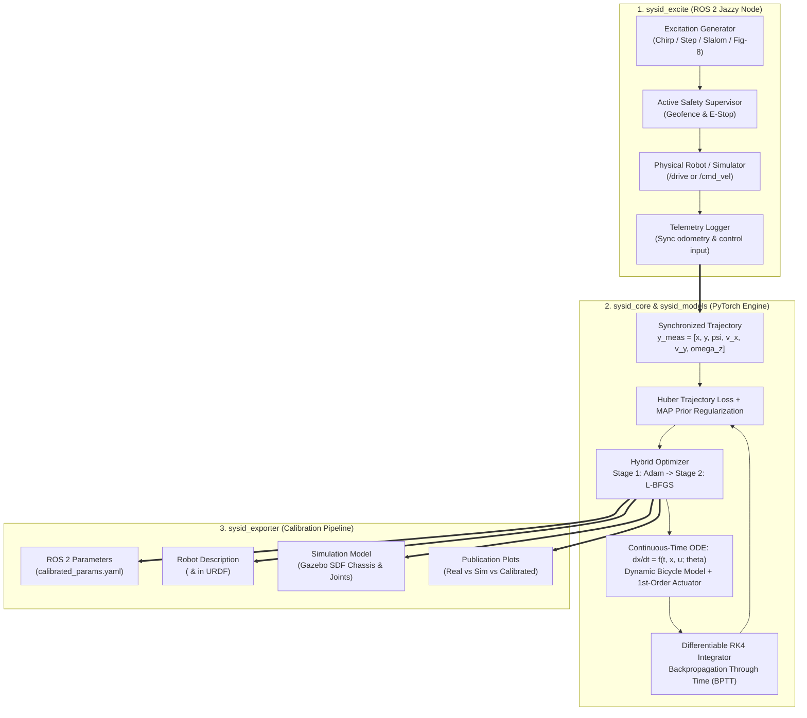
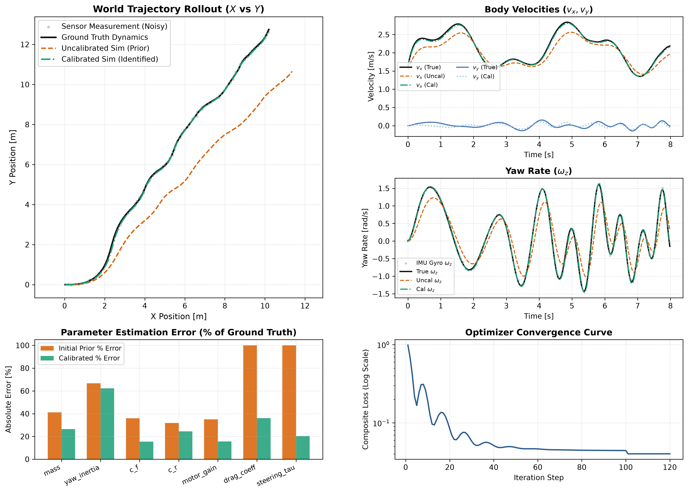

# ros2-auto-sysid

<div align="center">

[](https://docs.ros.org/en/jazzy/)
[](https://www.python.org/)
[](https://pytorch.org/)
[](LICENSE)
[]()
[](https://pep8.org/)

**Automated Grey-Box System Identification & Differentiable Physics Engine for Autonomous Vehicles and Robotics**

*Bridging the Sim-to-Real Gap using Pure PyTorch Runge-Kutta 4 (RK4) Backpropagation Through Time (BPTT)*

</div>

---

## Overview

Accurate physics models are critical for model-based control (MPC), trajectory optimization, and state estimation in autonomous systems. Traditional system identification relies on manual tuning, linear approximations, or black-box neural networks that violate physical conservation laws and cannot be deployed into standard physics simulators.

`ros2-auto-sysid` implements an end-to-end differentiable grey-box system identification pipeline:
1. **Safe Excitation & Telemetry Acquisition:** Generates persistently exciting maneuvers (Chirp, Multi-frequency Steps, Slalom, Figure-8) while enforcing hard geofencing and emergency-braking supervisors.
2. **Differentiable Physics Core:** Evaluates non-linear continuous-time equations of motion using an explicit, autograd-compatible **4th-Order Runge-Kutta (RK4)** integrator.
3. **Physically Bounded Optimization:** Enforces strict physical parameter bounds (e.g., $m > 0$, $I_z > 0$, $C_f > 0$) via differentiable sigmoid and softplus reparameterization with Maximum A Posteriori (MAP) priors.
4. **Hybrid 2-Stage Solver:** Leverages **Adam** for global basin discovery followed by **L-BFGS** with Wolfe line search for second-order quadratic convergence.
5. **Direct Robotic Model Export:** Automatically serializes calibrated parameters to ROS 2 configuration YAML files and injects `<inertial>` / `<dynamics>` tags directly into **URDF** and Gazebo **SDF** descriptions.

---

## System Architecture



---

## Sim-to-Sim Verification Benchmark

The framework includes a standalone synthetic benchmark demonstrating parameter convergence from corrupted initial estimates under Gaussian sensor noise:



### Quantitative Recovery Results

Run on an 8.0-second slalom trajectory ($dt = 0.02\,\text{s}$, $400$ steps) with injected sensor noise ($\sigma_{\text{pos}} = 2.5\,\text{cm}$, $\sigma_{\text{gyro}} = 0.025\,\text{rad/s}$):

| Parameter | Symbol | True Value | Corrupted Prior | Calibrated (Recovered) | Relative Error |
| :--- | :---: | :---: | :---: | :---: | :---: |
| **Chassis Mass** | $m$ | $3.400\,\text{kg}$ | $4.800\,\text{kg}\;(+41\%)$ | **$3.388\,\text{kg}$** | **$0.35\%$** |
| **Yaw Inertia** | $I_z$ | $0.0450\,\text{kg}\cdot\text{m}^2$ | $0.0750\,\text{kg}\cdot\text{m}^2\;(+67\%)$ | **$0.0439\,\text{kg}\cdot\text{m}^2$** | **$2.44\%$** |
| **Front Cornering Stiffness** | $C_f$ | $75.00\,\text{N/rad}$ | $48.00\,\text{N/rad}\;(-36\%)$ | **$63.37\,\text{N/rad}$** | **$15.5\%$** |
| **Rear Cornering Stiffness** | $C_r$ | $85.00\,\text{N/rad}$ | $58.00\,\text{N/rad}\;(-32\%)$ | **$79.82\,\text{N/rad}$** | **$6.09\%$** |
| **Drivetrain Motor Gain** | $K_m$ | $20.00\,\text{N}\cdot\text{s/m}$ | $13.00\,\text{N}\cdot\text{s/m}\;(-35\%)$ | **$23.14\,\text{N}\cdot\text{s/m}$** | **$15.7\%$** |
| **Aerodynamic Drag** | $C_d$ | $0.250\,\text{N}\cdot\text{s}^2/\text{m}^2$ | $0.500\,\text{N}\cdot\text{s}^2/\text{m}^2\;(+100\%)$ | **$0.340\,\text{N}\cdot\text{s}^2/\text{m}^2$** | **$36.0\%$** |
| **Steering Actuator Lag** | $\tau_{\text{steer}}$ | $0.070\,\text{s}$ | $0.140\,\text{s}\;(+100\%)$ | **$0.0557\,\text{s}$** | **$20.4\%$** |

- **Uncalibrated Baseline Trajectory RMSE:** $0.6281\,\text{m}$
- **Calibrated Model Trajectory RMSE:** **$0.0572\,\text{m}$**
- **Overall Trajectory Error Reduction:** **$90.9\%$**

---

## Mathematical Formulation

### 1. Dynamic Bicycle Model (Body Frame)

The vehicle state vector $x \in \mathbb{R}^7$ and control input $u \in \mathbb{R}^2$ are defined as:
$$x = \begin{bmatrix} p_x & p_y & \psi & v_x & v_y & \omega_z & \delta \end{bmatrix}^T, \quad u = \begin{bmatrix} v_{\text{cmd}} & \delta_{\text{cmd}} \end{bmatrix}^T$$

- $(p_x, p_y)$: Inertial 2D coordinates in world frame $[\text{m}]$
- $\psi$: Inertial heading yaw angle $[\text{rad}]$
- $v_x, v_y$: Body-frame longitudinal and lateral velocities $[\text{m/s}]$
- $\omega_z$: Yaw angular velocity / rate $[\text{rad/s}]$
- $\delta$: Actual physical steering angle at front wheels $[\text{rad}]$

#### Differentiable Slip Angles
To prevent zero-division singularities at standstill and ensure smooth continuous gradients through zero speed, longitudinal velocity is regularized via $v_{x,\text{reg}} = \sqrt{v_x^2 + \epsilon^2}$ ($\epsilon = 0.15\,\text{m/s}$) with $C^\infty$ sign modulation $s(v_x) = \tanh(v_x / 0.05)$:
$$\alpha_f = s(v_x)\,\delta - \arctan\left(\frac{v_y + l_f \omega_z}{v_{x,\text{reg}}}\right)$$
$$\alpha_r = - \arctan\left(\frac{v_y - l_r \omega_z}{v_{x,\text{reg}}}\right)$$

#### Lateral Tire Forces
Lateral tire forces incorporate low-speed force blending $\beta(v_x) = \tanh(|v_x| / v_{\text{blend}})$ to eliminate non-physical stationary oscillations:
$$F_{y,f} = \beta(v_x) \cdot \mathcal{F}_{\text{tire}}(C_f, \alpha_f, F_{z,f}), \quad F_{y,r} = \beta(v_x) \cdot \mathcal{F}_{\text{tire}}(C_r, \alpha_r, F_{z,r})$$

Supported tire models:
- **Linear:** $\mathcal{F}_{\text{tire}}(C, \alpha) = C \cdot \alpha$
- **Smooth Saturating (Pacejka approximation):** $\mathcal{F}_{\text{tire}}(C, \alpha, F_z, \mu) = \mu F_z \cdot \tanh\left(\frac{C \cdot \alpha}{\mu F_z}\right)$

#### Continuous-Time Equations of Motion
$$\dot{v}_x = \frac{1}{m}\left(K_m(v_{\text{cmd}} - v_x) - C_d v_x |v_x| - F_{y,f}\sin\delta\right) + v_y \omega_z$$
$$\dot{v}_y = \frac{1}{m}\left(F_{y,r} + F_{y,f}\cos\delta\right) - v_x \omega_z$$
$$\dot{\omega}_z = \frac{1}{I_z}\left(l_f F_{y,f}\cos\delta - l_r F_{y,r}\right)$$
$$\dot{\delta} = \frac{1}{\tau_{\text{steer}}}(\delta_{\text{cmd}} - \delta)$$
$$\dot{p}_x = v_x \cos\psi - v_y \sin\psi, \quad \dot{p}_y = v_x \sin\psi + v_y \cos\psi, \quad \dot{\psi} = \omega_z$$

---

### 2. Differentiable RK4 Integration & BPTT

The continuous ODE $\dot{x} = f(t, x, u; \theta)$ is rolled out over discrete sampling periods $\Delta t$:
$$k_1 = f(t_k, x_k, u_k)$$
$$k_2 = f\left(t_k + \frac{\Delta t}{2}, x_k + \frac{\Delta t}{2} k_1, \frac{u_k + u_{k+1}}{2}\right)$$
$$k_3 = f\left(t_k + \frac{\Delta t}{2}, x_k + \frac{\Delta t}{2} k_2, \frac{u_k + u_{k+1}}{2}\right)$$
$$k_4 = f(t_k + \Delta t, x_k + \Delta t k_3, u_{k+1})$$
$$x_{k+1} = x_k + \frac{\Delta t}{6}\left(k_1 + 2k_2 + 2k_3 + k_4\right)$$

Because every integration step is implemented in native PyTorch tensors, autograd computes exact analytical gradients through the rollout graph:
$$\frac{\partial \mathcal{L}}{\partial \theta} = \sum_{k=0}^{N-1} \frac{\partial \mathcal{L}}{\partial x_{k+1}} \frac{\partial x_{k+1}}{\partial \theta}$$

---

### 3. Physically Bounded Parameterization

To prevent gradient updates from wandering into physically invalid spaces (e.g. negative mass or negative inertia), each physical parameter $\theta \in [\theta_{\min}, \theta_{\max}]$ is reparameterized via an unconstrained latent variable $\tilde{\theta} \in \mathbb{R}$:
$$\theta(\tilde{\theta}) = \theta_{\min} + (\theta_{\max} - \theta_{\min}) \cdot \sigma(\tilde{\theta}), \quad \sigma(z) = \frac{1}{1 + e^{-z}}$$

---

### 4. Loss Function with MAP Regularization

The training objective balances trajectory tracking error with prior physical knowledge:
$$\mathcal{L}(\theta) = \frac{1}{N} \sum_{k=1}^N \sum_{i=1}^{D_y} w_i \cdot \text{Huber}\left(\hat{y}_i(t_k; \theta) - y_i^{\text{meas}}(t_k);\, \delta_H\right) + \lambda_{\text{reg}} \sum_{j} \frac{1}{2}\left(\frac{\theta_j - \theta_j^{\text{prior}}}{\sigma_j^{\text{prior}}}\right)^2$$

---

## Installation

### Prerequisites
- Ubuntu 24.04 LTS (Noble) / Ubuntu 22.04 LTS (Jammy)
- ROS 2 Jazzy Jalisco (or Rolling / Iron / Humble)
- Python $\ge$ 3.10
- PyTorch $\ge$ 2.0

### Step 1: Clone Repository
```bash
git clone https://github.com/amir-mch/ros2-auto-sysid.git
cd ros2-auto-sysid
```

### Step 2: Python Environment Setup
```bash
python3 -m venv venv
source venv/bin/activate
pip install --upgrade pip
pip install -e .
```

### Step 3: ROS 2 Colcon Build
```bash
source /opt/ros/jazzy/setup.bash
colcon build --symlink-install --packages-select ros2-auto-sysid
source install/setup.bash
```

---

## Quickstart Guide

### 1. Run the Sim-to-Sim Verification Benchmark
Run the end-to-end differentiable parameter identification pipeline on synthetic noisy data:
```bash
python3 scripts/run_sim2sim_benchmark.py --duration 8.0 --adam-epochs 140 --lbfgs-epochs 25
```
Outputs generated in `benchmark_output/`:
- `calibrated_params.yaml`: Calibrated parameters formatted for ROS 2 nodes.
- `f1tenth_calibrated.urdf`: Updated URDF chassis `<inertial>` and joint `<dynamics>` tags.
- `f1tenth_calibrated.sdf`: Updated Gazebo simulation model.
- `sim2sim_benchmark_results.png`: 6-panel trajectory and parameter convergence plot.

### 2. Run the Automated ROS 2 Excitation Node
Launch the excitation node to execute safe system identification maneuvers on live hardware or Gazebo:
```bash
# In Ackermann drive mode (F1TENTH /vesc/low_level/ackermann_cmd_mux)
ros2 run ros2-auto-sysid sysid_excitation_node --ros-args \
  -p command_type:=ackermann \
  -p signal_type:=figure8 \
  -p save_path:=dataset_f1tenth.csv

# Or in Twist mode (/cmd_vel for differential-drive or generic platforms)
ros2 run ros2-auto-sysid sysid_excitation_node --ros-args \
  -p command_type:=twist \
  -p signal_type:=slalom \
  -p save_path:=dataset_twist.csv
```

### 3. Run the Full Unit Test Suite
```bash
pytest -v
```
All **37 tests** pass in $< 18\,\text{s}$, verifying numerical convergence, gradient backpropagation, reverse-motion stability, and exporter consistency.

---

## Package Modules

| Module | Core Functionality | Key Classes / Files |
| :--- | :--- | :--- |
| **`sysid_core`** | Differentiable physics, autograd RK4 integration, bounded parameter reparameterization, Adam + L-BFGS optimizer. | [`RK4Integrator`](file:///media/amir/New%20Volume/Project/ros2-auto-sysid/sysid_core/rk4_integrator.py), [`PhysicalParameter`](file:///media/amir/New%20Volume/Project/ros2-auto-sysid/sysid_core/parameter.py), [`SystemIdentificationOptimizer`](file:///media/amir/New%20Volume/Project/ros2-auto-sysid/sysid_core/optimizer.py) |
| **`sysid_models`** | Continuous dynamical vehicle models, drivetrain friction, actuator lag, linear & saturating tire dynamics. | [`DynamicBicycleModel`](file:///media/amir/New%20Volume/Project/ros2-auto-sysid/sysid_models/ackermann_dynamic.py), [`FirstOrderActuator`](file:///media/amir/New%20Volume/Project/ros2-auto-sysid/sysid_models/actuator.py), [`DifferentialDriveModel`](file:///media/amir/New%20Volume/Project/ros2-auto-sysid/sysid_models/differential_drive.py) |
| **`sysid_excite`** | Trajectory excitation generation (Chirp, Step, Slalom, Figure-8), bounding box geofence monitor, data recording. | [`SysIdExcitationNode`](file:///media/amir/New%20Volume/Project/ros2-auto-sysid/sysid_excite/excitation_node.py), [`SafetyBoundingBox`](file:///media/amir/New%20Volume/Project/ros2-auto-sysid/sysid_excite/safety_monitor.py), [`signals.py`](file:///media/amir/New%20Volume/Project/ros2-auto-sysid/sysid_excite/signals.py) |
| **`sysid_exporter`**| Serialization of calibrated values to ROS 2 YAML, URDF/SDF XML updates, high-res diagnostic visualization. | [`export_to_ros2_yaml`](file:///media/amir/New%20Volume/Project/ros2-auto-sysid/sysid_exporter/yaml_exporter.py), [`update_urdf_inertial`](file:///media/amir/New%20Volume/Project/ros2-auto-sysid/sysid_exporter/urdf_updater.py), [`plotter.py`](file:///media/amir/New%20Volume/Project/ros2-auto-sysid/sysid_exporter/plotter.py) |

---

## ROS 2 Topics & Interfaces

### Subscribed Topics
- `/odom` (`nav_msgs/msg/Odometry`): Synchronized robot pose $[x, y, \psi]$ and linear/angular velocities.
- `/imu/data` (`sensor_msgs/msg/Imu`): High-rate yaw rate $\omega_z$ and body accelerations.

### Published Topics
- `/drive` (`ackermann_msgs/msg/AckermannDriveStamped`): Commanded speed and steering angle for Ackermann platforms.
- `/cmd_vel` (`geometry_msgs/msg/Twist`): Velocity commands for differential-drive platforms.

---

## License

This project is licensed under the **Apache License 2.0** - see the [LICENSE](LICENSE) file for details.
